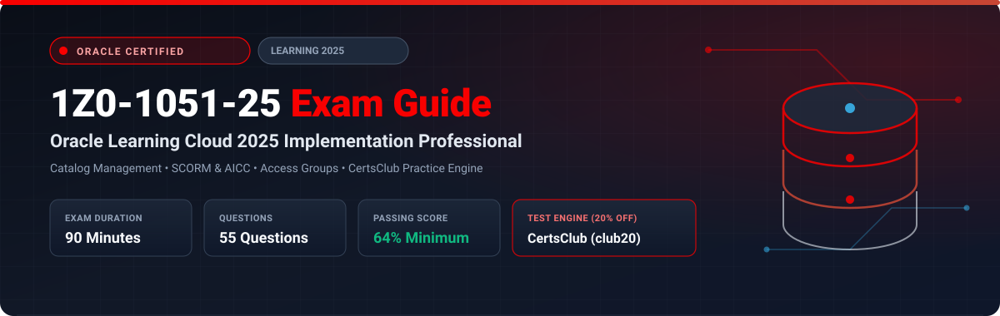

  

# Oracle Learning Cloud 2025 Implementation Professional (1Z0-1051-25) Exam Study Guide & Practice Test Resource Portal

[-f80000?style=for-the-badge&logo=oracle&logoColor=white)](https://education.oracle.com/)
[-f80000?style=for-the-badge&logo=oracle)](https://education.oracle.com/)

[-28a745?style=for-the-badge&logo=shield)](https://www.certsclub.com/oracle/)

---

## 1. Exam Overview & Candidate Profile

The **Oracle Learning Cloud 2025 Implementation Professional (1Z0-1051-25)** exam validates that an implementation consultant can configure and administer Oracle Fusion Cloud Learning. Key topics include managing the Learning Catalog (Courses, Offerings, Activities, Specializations), importing eLearning content (SCORM, AICC, Video), configuring Access Groups, managing Required and Voluntary learning assignments, community forums, and tracking completion analytics.

Passing 1Z0-1051-25 earns the **Oracle Learning Cloud 2025 Certified Implementation Professional** credential.

### Target Candidate Profile & Career Roles
* **Oracle Learning Cloud Functional Consultants**
* **Corporate Training & L&D Systems Architects**
* **HCM Cloud Learning Administrators**

---

## 2. Key Exam Specifications

| Parameter | Official Specification |
| :--- | :--- |
| **Exam Code** | 1Z0-1051-25 |
| **Exam Title** | Oracle Learning Cloud 2025 Implementation Professional |
| **Associated Credential** | Oracle Learning Cloud 2025 Certified Implementation Professional |
| **Duration** | 90 Minutes |
| **Number of Questions** | 55 Questions |
| **Passing Score** | 64% |
| **Question Format** | Multiple Choice (Single and Multiple Select) |
| **Delivery Vendor** | Pearson VUE / Oracle University Online Remote Proctoring |
| **Recommended Practice Test Engine** | **[1Z0-1051-25 Practice Test - CertsClub](https://www.certsclub.com/oracle/)** (Coupon: `club20` for 20% off) |

---

## 3. Official Blueprint & Exam Domain Breakdown

| Domain Code | Domain Title | Weighting | Key Competencies Covered |
| :--- | :--- | :---: | :--- |
| **1.0** | **Learning Catalog Hierarchy** | **25%** | Catalog structure: Courses -> Offerings (Instructor-Led, Self-Paced, Blended) -> Activities; Specializations and Learning Paths. |
| **2.0** | **Content Management & Providers** | **20%** | SCORM 1.2 / 2004, AICC, Web links, Video transcoding, External content providers (LinkedIn Learning, Coursera). |
| **3.0** | **Access Groups & Assignment Rules** | **25%** | Access Groups, Dynamic assignment initiatives, Required compliance assignments, Expiration and validity rules. |
| **4.0** | **Social Learning & Communities** | **15%** | Learning Communities, Collaborative learning, Peer recommendations, Community catalog management. |
| **5.0** | **Learning Approvals & OTBI Analytics** | **15%** | Approval rules, Manager withdrawals, OTBI Learning Real Time subject areas, Compliance dashboards. |

---

## 4. Scenario-Based Demo Question & Explanation

### Question 1: Learning Catalog Hierarchy
**Scenario:** A company offers a mandatory "Annual Cybersecurity Training" course. The training consists of an online self-paced video module followed by an optional instructor-led Q&A session.

How should this curriculum be structured in the Oracle Learning Catalog?

A) As two separate unlinked courses.  
B) As a single **Course** that contains a **Blended Offering**, which includes both the self-paced activity and the instructor-led activity.  
C) As a Profile Extension Table.  
D) As a fast formula.  

**Correct Answer:** **B**

**Detailed Explanation:**
* In Oracle Learning Cloud, a **Course** represents the high-level topic. Under the course, an **Offering** defines the delivery mode (Instructor-Led, Self-Paced, or **Blended**). A Blended Offering accommodates multiple activity types within a single enrollment.

---

## 5. Recommended Preparation Strategy & Practice Testing Engine

1. **Build a Catalog Hierarchy in Sandbox:** Create courses with self-paced and blended offerings, upload SCORM packages, and test assignment initiatives.
2. **Practice with Full-Length Mock Exams:** Use **[CertsClub Oracle 1Z0-1051-25 Practice Tests](https://www.certsclub.com/oracle/)**.
   * Comprehensive questions covering catalog hierarchy, access groups, and assignment initiatives.
   * Enter discount coupon code **`club20`** at checkout on [CertsClub](https://www.certsclub.com/oracle/) for an immediate 20% discount.

---

## 6. Official Documentation & References

* [Oracle Fusion Cloud Learning Documentation](https://docs.oracle.com/en/cloud/saas/human-resources/learning/)
* [Oracle University 1Z0-1051-25 Exam Details](https://education.oracle.com/)
* [CertsClub 1Z0-1051-25 Practice Engine](https://www.certsclub.com/oracle/)
